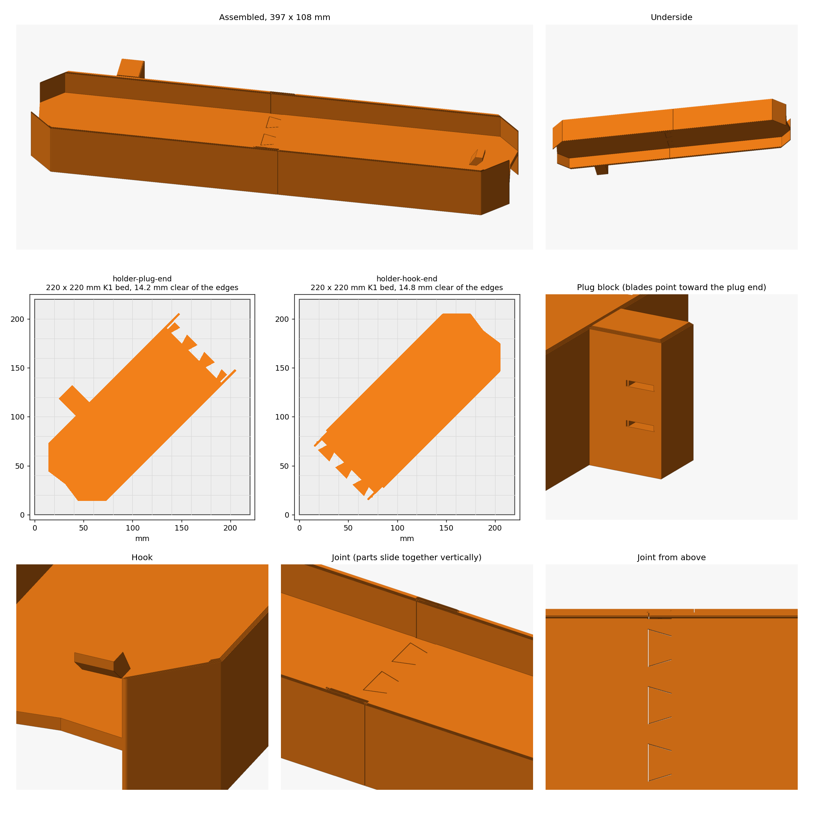
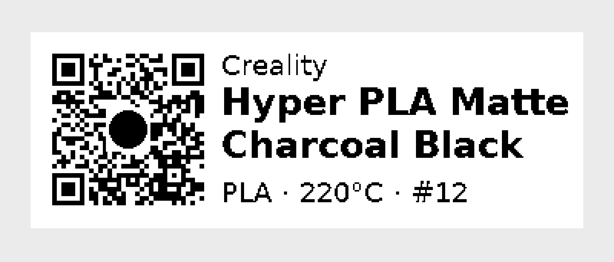

# 3D prints

Models for a Creality K1 (220 x 220 x 250 mm), sliced in OrcaSlicer.

Each print has its own folder with the STL, the script that generates it, and a render.

| Print | Picture |
| --- | --- |
| [Spiderweb light holder](spiderweb-light-holder/) |  |

## Rebuilding

```
python3 -m venv ~/.venvs/3d-prints
~/.venvs/3d-prints/bin/pip install -r requirements.txt
cd spiderweb-light-holder
~/.venvs/3d-prints/bin/python model.py
~/.venvs/3d-prints/bin/python ../tools/render.py build/assembled.stl render.png \
  --parts holder-plug-end.stl holder-hook-end.stl \
  --views "Plug block,20,30,75,50,22,75;Hook,30,25,-30,0,26,70;Joint,35,-60,217,0,22,110"
```

`render.py` draws the assembled print, a bed plan for each part and any close-ups given with
`--views` as `title,elevation,azimuth,x,y,z,span` (a negative x counts back from the far end).

## Spool labels

Filament is tracked in [Spoolman](https://github.com/Donkie/Spoolman), and each storage
container gets a label printed on a Brother P-touch Cube Plus (PT-P710BT).

| 24 mm tape | 12 mm tape |
| --- | --- |
|  |  |

The QR code is a Home Assistant tag (`https://www.home-assistant.io/tag/spool<id>`). Scan it
with the iPhone camera and tap the notification. Home Assistant then makes that spool the K1's
active spool in Moonraker, and its notification links to the spool's Spoolman page. The
automation is `k1_set_active_spool` in the home-assistant-config repo.

### Printing

1. In Spoolman, open **Labels** and pick **P-touch 24mm spool** or **P-touch 12mm spool**
   to match the tape in the printer. Select the spools and export. You get one 180 dpi PNG
   per spool; more than five come as a zip.
2. Connect the P-touch to the Mac with its USB cable. The PT-P710BT doesn't support
   Bluetooth to computers, and there's no Mac print driver, so use
   [P-touch Editor](https://apps.apple.com/app/brother-p-touch-editor/id1453365242) (App
   Store). Spoolman's **Print** button can't reach this printer.
3. In P-touch Editor, open View > Inspector > Paper. Set the tape size to match the cassette,
   set **Length** to Auto (or the fixed length below), and set the margins to the smallest
   value allowed. The labels already have their own white border: about 2 mm on the left
   and 1 mm on the right.
4. Insert the PNG and set it to the exact size below, centred vertically. Don't stretch it
   to the full tape width.
5. For several labels, print them as one job with **Auto Cut** and **Chain Printing** on.
   Otherwise the printer feeds about 25 mm of blank tape before every label. Turn Chain
   Printing off for the last label so it gets cut.

| Tape | Printable height | Image size | Length with 2 mm margins |
| --- | --- | --- | --- |
| 24 mm | 128 dots (18.06 mm) | 50.8 x 18.06 mm | ~55 mm |
| 12 mm | 76 dots (10.72 mm) | 40.64 x 10.72 mm | ~45 mm |

### Why that size

The PT-P710BT prints at 180 dpi and can't reach the tape edges. Each design is exactly the
printable height, and every element is placed in whole printer dots. A QR module is 3 dots
on 24 mm tape and 2 dots on 12 mm, so the codes print sharp, and the white margin around
each code is wide enough to scan. Scaling the image in P-touch Editor breaks that alignment.
The labels are black only, because the printer can't print colour.

The 12 mm QR stays this size up to spool #999. From #1000 the code has more modules and
they no longer fall on whole dots.

### Changing the designs

`spool-labels/labels.py` defines both designs. It writes `designs.json` and the previews:

```
~/.venvs/3d-prints/bin/python spool-labels/labels.py spool-labels
```

Spoolman keeps label designs in its `label_designs` setting. To load new versions, merge
`designs.json` into that setting and POST it to `/api/v1/setting/label_designs`. The value
must be the JSON array encoded as a string. Small tweaks can also be made in Spoolman's
label designer. It doesn't show the QR error-correction level, though: the 24 mm design uses
Q and the 12 mm design uses M.
