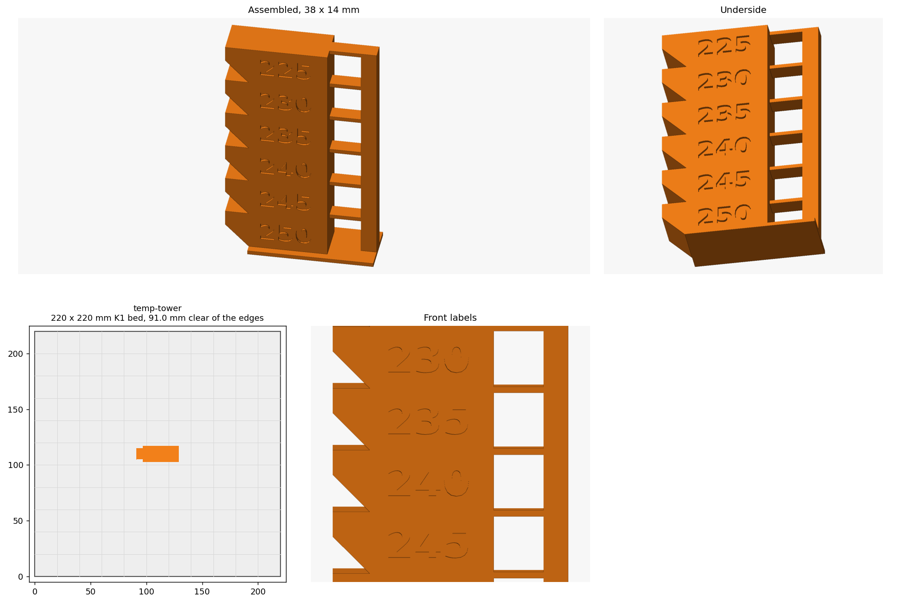

# PETG calibration

Tests for tuning a PETG spool on the K1. They start from Creality's generic PETG profile
(250 °C nozzle, 70 °C bed).

## Temperature tower



Six 10 mm blocks, from 250 °C at the bottom down to 225 °C at the top in 5 °C steps,
each with its temperature engraved on the front. Each block has:

- a 45° overhang on the left, which curls or droops when the plastic is too hot,
- an 8 mm bridge at its top, which sags when the plastic is too hot,
- a 4 mm post across an 8 mm gap, where strings show up when the plastic is too hot.

Too cold shows up as a dull, rough surface and layers that split when you bend the tower.
Pick the coolest block that still looks glossy and holds together, then set that as the
nozzle temperature for the spool.

To make it:

```
~/.venvs/3d-prints/bin/python model.py
# slice temp-tower.stl at 250 °C, then add the temperature changes:
~/.venvs/3d-prints/bin/python set_temps.py plate_1.gcode petg-temp-tower-250-225.gcode
```

`set_temps.py` adds an `M104` at the first layer of each block.

## Results

| Spool | Date | Best temperature | Notes |
| --- | --- | --- | --- |
| Inland Black PETG (Spoolman #10) | 2026-11-15 | 240 °C | All six blocks looked about the same: almost no stringing, clean 8 mm bridges, even overhangs. The 250 label was slightly softer. Picked the middle of the clean range. |

For tiny parts such as the thermostat hood's 2.6 mm pegs, temperature isn't the problem:
each layer prints in under a second and has no time to cool. Print several copies at once,
and use the K1's side fan (`additional_cooling_fan_speed` 40) with `slow_down_min_speed`
10 mm/s.
