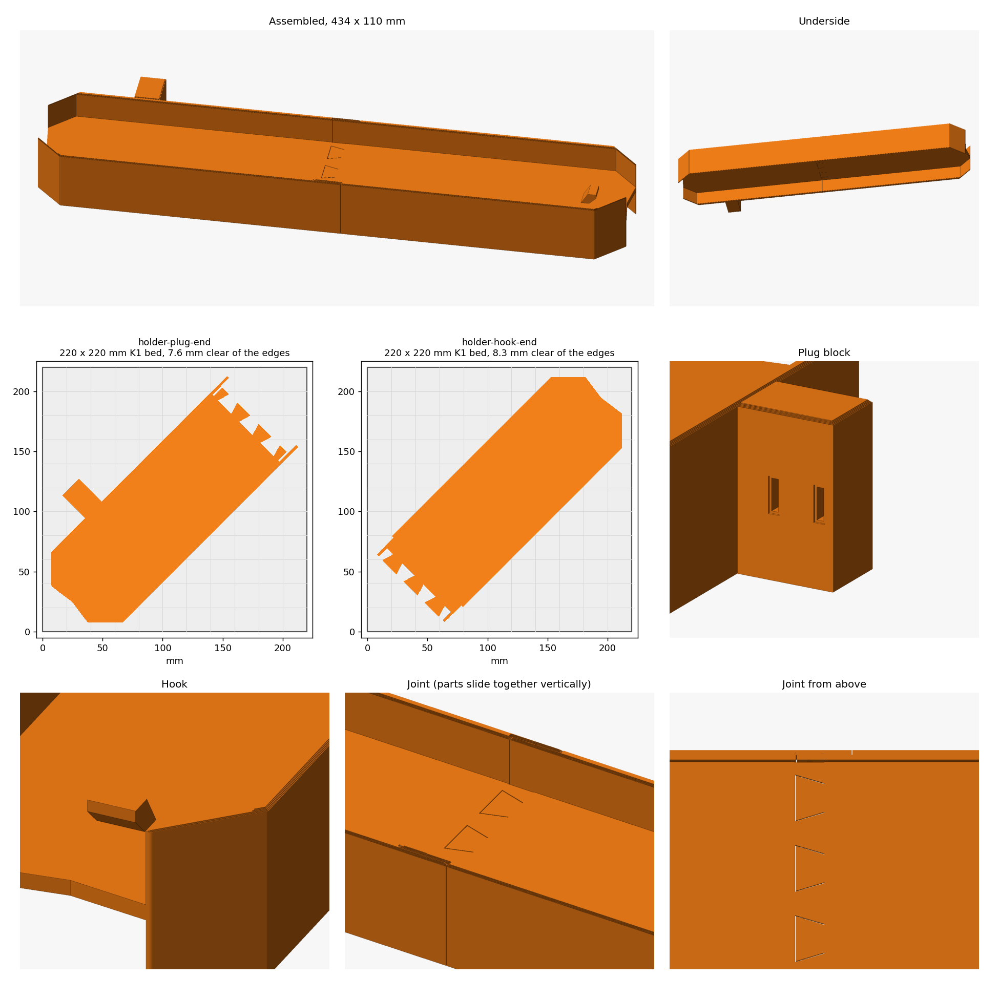

# Spiderweb light holder

A winder for a large spiderweb light gathered into a single strand. The strand wraps
lengthwise around the ends, and lips on both faces keep it from sliding off the sides.

- Two parts, 434 mm long when assembled, with a 76 mm channel and 20 mm lips on each face.
  Each part is as long as the K1 bed diagonal allows, and the STLs are already turned onto it.
- To assemble, hold the hook end above the plug end and slide it straight down: the web
  dovetails drop into their sockets and the lip halves overlap until the bumps click into
  their dimples. It doesn't come apart afterwards.
- To start winding, tuck the ring's wire under the hook on the top channel floor and lay the
  ring flat. The hook reaches toward the end, so pulling the strand toward the plug seats it.
  It's sized for a ring of about 42-45 mm in 2 mm wire, measured from a photo.
- To finish, push the plug's blades into the block on the outside of the plug end, label up,
  so the body sits beside the holder and the channel stays clear. Bring the last wrap around
  the end and back to the plug, so tension pushes the blades in, not out.

## Printing

Import each STL into OrcaSlicer and leave it where it lands, without rotating or auto-arranging it.

| Setting | Value |
| --- | --- |
| Printer | Creality K1 (0.4 nozzle) |
| Process | 0.20mm Standard |
| Filament | PLA, about 305 g for both parts, much of it support |
| Supports | **On, build plate only.** The underside channel's floor spans it 20 mm up. |
| Brim | None |
| Time | About 3.5 hours per part |

Change the dimensions at the top of `model.py`, then rerun it. `SLOT_THICKNESS` sets the plug's grip.
