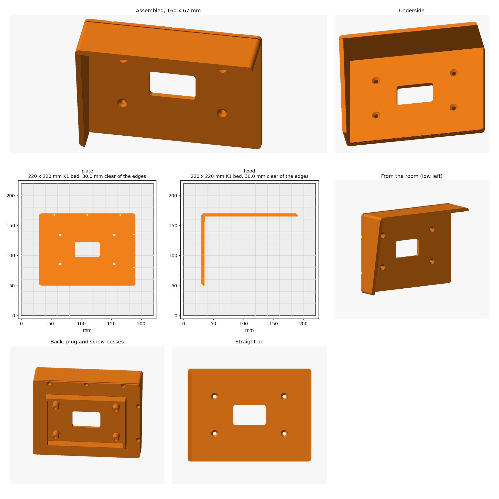

# Thermostat wall plate with sun hood

A plate for the downstairs ecobee Smart Thermostat Premium. A hollow plug fills the notch
the previous owners cut in the paneling (121 x 80 mm, 18 mm deep). A 160 x 120 mm face laps onto the paneling and frames the 104 mm ecobee. An
L-shaped hood along the top and left edges keeps direct sun off the thermostat. It sticks
out 45 mm at the top, about 19 mm past the front of the ecobee, and the left side tapers
to 22 mm at the bottom.

## Parts

- `plate.stl` prints face down on the bed. It has the plug, four countersunk wall-screw holes
  hidden under the ecobee, and a 36 x 20 mm wire slot. There's no recess for the hood:
  one at the edge would float over the bed when the face prints down.
- `hood.stl` prints standing on the edge that sits on the plate.

## Install

1. Attach the hood first. Set it flush with the plate's top and left edges and drive five
   #4 x 1/2" flat-head screws from the back of the flange into its 2 mm pilots. A thin
   line of CA glue along the joint also works.
2. Feed the cable through the plug and the wire slot. Plug the hole in the wall around the
   cable with putty or foam so draughts from the wall cavity don't reach the sensor.
3. Press the plug into the notch and screw the plate to the notch floor with four #6 or #8
   flat-head wood screws, about 1-1/4" long.
4. Hold the ecobee back plate over the wire slot and mark its holes. Drill 2.5 mm pilots
   (the face is 5 mm thick) and screw it on with the ecobee's screws. If one of its holes
   lands on a wall screw, turn the back plate slightly.

## Printing

| Setting | Value |
| --- | --- |
| Printer | Creality K1 (0.4 nozzle) |
| Process | 0.20mm Standard, 4 walls, 15% infill |
| Plate | About 80 g of PETG and 2.5 hours, 250 °C nozzle and 70 °C bed |
| Filament | **PETG or ASA, not PLA.** The plate sits in direct sun on a black wall, and PLA softens at about 55 °C. |
| Supports | None |
| Brim | None |

The sizes are at the top of `model.py`. Change them and rerun it. `NOTCH_W`, `NOTCH_H` and
`FIT` set how the plug fits the notch, and `HOOD_TOP_DEPTH` sets how far the hood sticks out.
